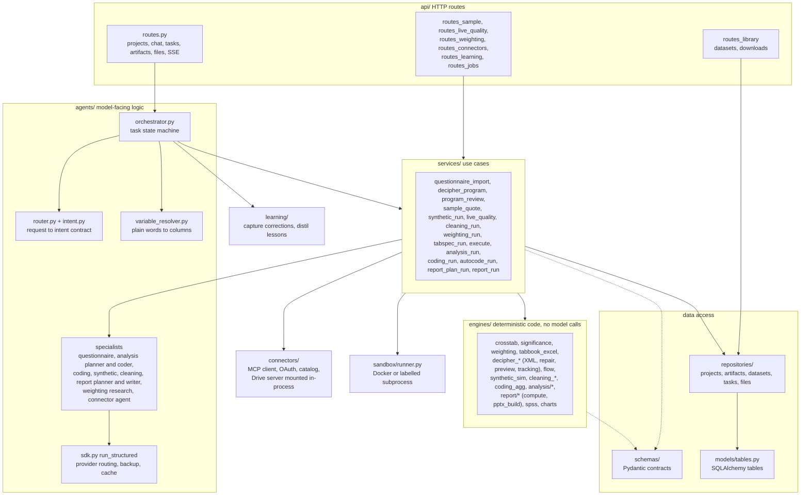
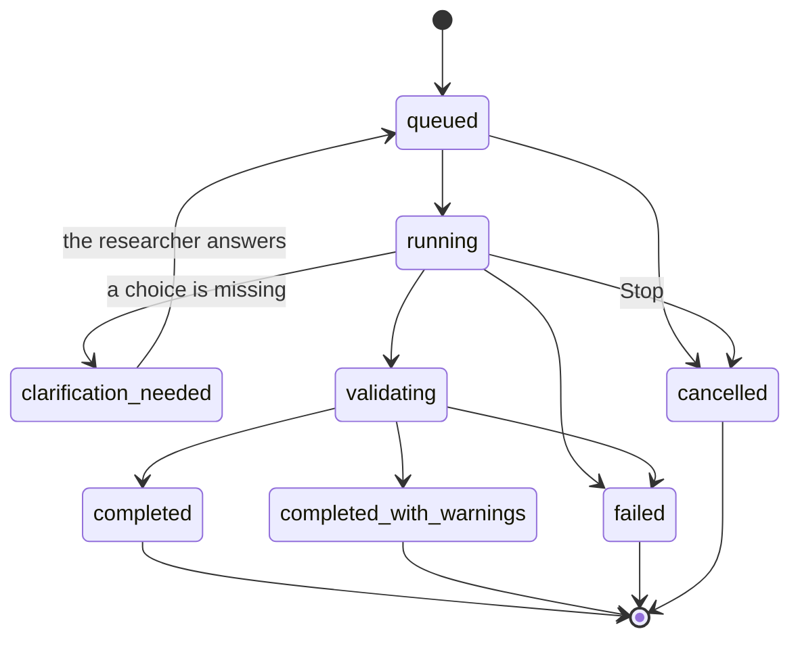
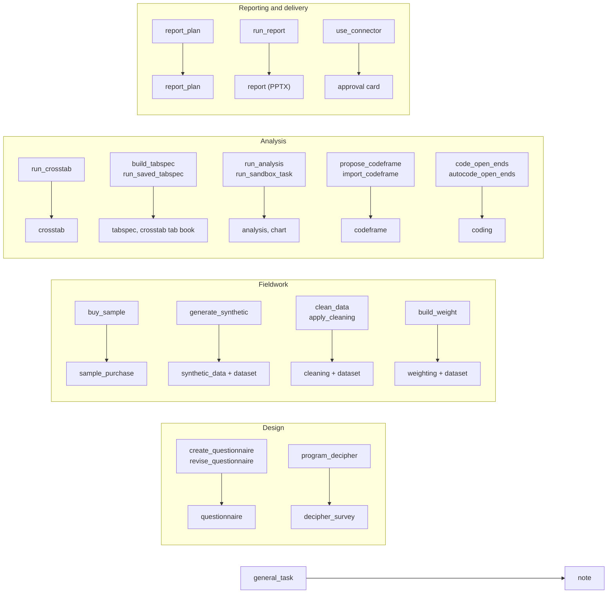
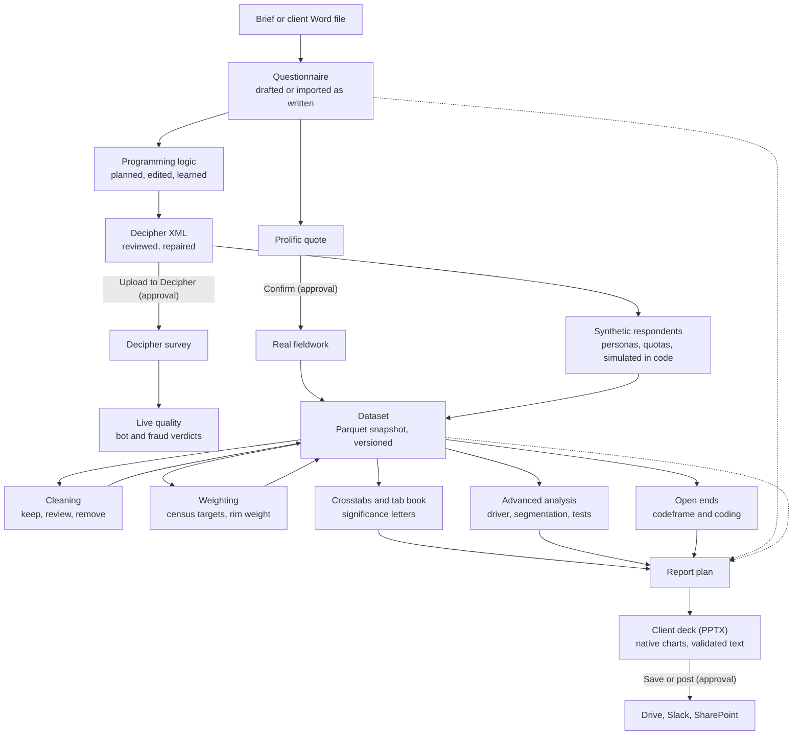
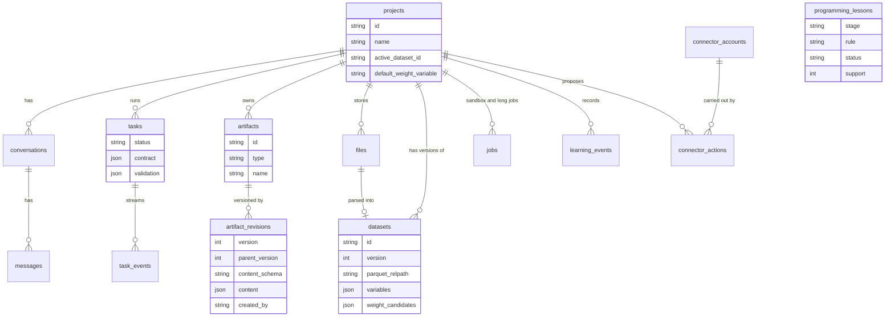
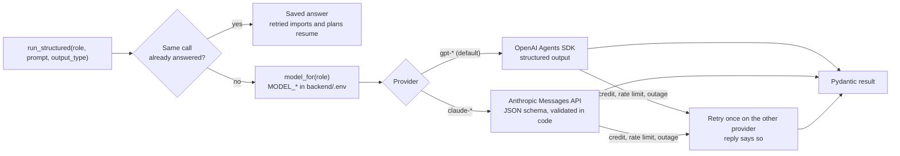
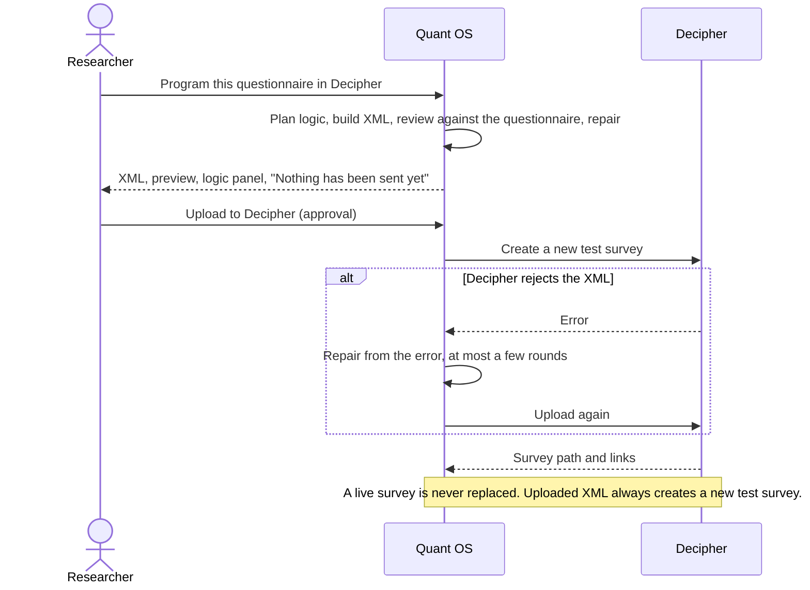
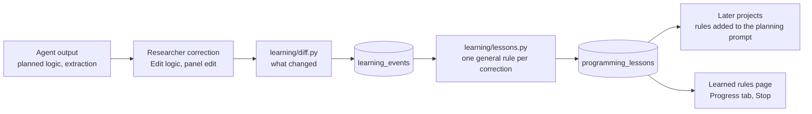

# Quant OS system architecture

Quant OS takes a survey study from a client brief to a client-ready deck. A researcher works in one browser workspace: a chat drives specialist agents, and every output (questionnaire, Decipher survey, tab spec, tables, analyses, codeframe, weight, report) is an editable, versioned artifact.

It runs as a **local single-user app**: a FastAPI backend and a Vite/React frontend on the researcher's machine. Outside services are called only from the backend, so no key reaches the browser.

**Ground rules the design follows:**
- **Numbers come from code, never from a model.** Crosstabs, significance, weights, statistics, code frequencies and every chart value are computed in Python. Models plan, draft, map and write words; a validator checks the words against the computed results.
- **The researcher can edit everything.** Chat edits and panel edits go through the same revision API, with optimistic locking.
- **Nothing outside the app changes without a click.** Decipher uploads, Prolific purchases and connector writes (Drive, Slack and so on) wait for an approval.

Related documents: [DATA_CONTRACTS.md](DATA_CONTRACTS.md) (schemas), [PRD.md](PRD.md) (product), [README.md](README.md) (setup and features), [demo/DEMO_PLAN.md](demo/DEMO_PLAN.md) (demo runbook).

---

## 1. System context

| Boundary | What crosses it | Control |
|---|---|---|
| Browser to backend | Requests, task events (server-sent events) | Vite proxies `/api`; keys stay in `backend/.env` |
| Backend to model providers | Questionnaire text, variable labels, aggregated results, open-end batches | No respondent-level numbers are needed for any computed result |
| Backend to sandbox | A checked analysis script and the data it needs | `--network none`, no API keys, restricted imports and file access |
| Backend to Decipher, Prolific, MCP tools | Survey XML, sample orders, files and messages | Every write waits for an approval card or button |
| Respondents to bot-detection API | Behaviour events from the survey page | Signed survey token; the API stores only allowed event types |

---

## 2. Backend layers

The backend is one FastAPI process. Requests enter through `api`, chat tasks run through the `agents` orchestrator, the work happens in `services`, and anything numeric happens in `engines`, which make no model calls.

| Folder | Role | Rule |
|---|---|---|
| `api/` | HTTP routes under `/api` | Thin: validate, call a service, commit |
| `agents/` | Intent routing, the orchestrator, and every model call | All model calls go through `sdk.run_structured` (or a provider client for web search) |
| `services/` | One module per use case, called by routes and the orchestrator | Commits before long model calls so the database isn't held open |
| `engines/` | Crosstabs, significance, raking, Decipher XML, SPSS, Excel, PPTX, simulation | No model calls, so every number can be reproduced |
| `repositories/` | Database reads and writes | Artifact edits check `expected_version` |
| `schemas/` | Pydantic contracts shared by API, agents and engines | See DATA_CONTRACTS.md |
| `learning/` | Turns researcher corrections into reusable rules | Rules are shown on the Learned rules page |
| `connectors/` | MCP client, OAuth, the connector catalog, and an in-process Drive server | Writes become approval cards |
| `sandbox/` | Runs generated analysis scripts | Docker with `--network none`, or a clearly labelled subprocess fallback |

---

## 3. A chat request, end to end

Every chat message becomes a **task**. The route returns at once, and the orchestrator runs the task in the background, streaming stage messages to the browser.

```mermaid
sequenceDiagram
    autonumber
    actor R as Researcher
    participant UI as Frontend
    participant API as routes.py
    participant O as Orchestrator
    participant RT as Router and resolver
    participant S as Service
    participant E as Engines
    participant M as Model (OpenAI)
    participant DB as SQLite and files

    R->>UI: Types a request
    UI->>API: POST /conversations/{id}/messages
    API->>DB: Save message, create task (queued)
    API-->>UI: task_id
    UI->>API: GET /tasks/{id}/events (SSE)
    API->>O: asyncio.create_task(run)
    O->>RT: Pick the intent
    Note over RT: Regex shortcuts first (weighting, redo, saved tab spec).<br/>Otherwise the router model returns an intent contract.
    RT->>M: Route and resolve plain-language variables
    alt A required choice is missing
        O-->>UI: clarification_needed, with the question
    else Ready
        O->>S: Dispatch the intent
        S->>M: Plan, draft or map (structured output)
        S->>E: Compute (tables, tests, weights, XML, deck)
        E-->>S: Results
        S->>DB: New artifact revision, files, dataset version
        S-->>O: Summary and validation
        O->>DB: Record the outcome for learning
        O->>S: Refresh the report plan if the study changed
        O-->>UI: completed, with a plain-words reply
    end
    UI->>API: Load the new artifact into its editor
```

**Task statuses:**

A finished task can be redone as a different intent ("Run tables", "Run as analysis"); the redo creates a new task from the original request.

---

## 4. Intents and what serves them

The router returns one of these intents. Each maps to one service and produces one artifact type.

---

## 5. The study lifecycle

How the artifacts feed each other over a study. Solid arrows are data flow; dotted arrows are the report plan quietly updating as the study changes.

---

## 6. Data model

SQLite (WAL mode) holds the records; files hold the content. Respondent data is stored as Parquet snapshots, and each change (cleaning, weighting, synthetic data) writes a new dataset version and makes it active.

**Artifact types:** `questionnaire`, `decipher_survey`, `sample_purchase`, `synthetic_data`, `cleaning`, `weighting`, `tabspec`, `crosstab`, `analysis`, `chart`, `codeframe`, `coding`, `report_plan`, `report`, `spec_review`, `note`.

**Concurrent edits:** chat and the editors both write through the revision API with `expected_version`. A mismatch returns HTTP 409, and the editor reloads the newer version.

---

## 7. Models and providers

Each agent role reads its model id from the environment. Every role defaults to OpenAI `gpt-6.1-sol`. Any role can be set to a Claude id (`claude-...`), which is then served by the Anthropic Messages API.

| Role | Used for | Session memory |
|---|---|---|
| `orchestrator` | Routing a request to an intent | Conversation session |
| `questionnaire` | Drafting, importing and planning logic | Conversation session |
| `validator` | Program review and checks | Conversation session |
| `tabspec`, `analysis` | Tab specs, analysis plans and scripts | Conversation session |
| `coding` | Codeframe proposals, open-end coding, cleaning open ends | **None**: each batch carries the codeframe (ids, labels, definitions) and its own rows |
| `synthetic` | Personas, quotas and answer profiles | **None**: each slice stands alone |
| `research` | Census targets: OpenAI web search, one search per variable in parallel, then mapping to answer codes | None |
| `general` | Everything else | Conversation session |
| AutoCoder | Ad Hoc AutoCoder (`MODEL_AUTOCODER`, `gpt-5-mini`) | Its own |

---

## 8. Integrations

### Decipher

### Live quality (bot and fraud detection)

When **Add tracking** is on, programming injects `assets/live_quality_tracker.js` into the survey XML with a signed survey token. Respondents' browsers send behaviour events (keystrokes, mouse, focus, page timing, grid answers, open-end text) to the bot-detection API. Quant OS reads that API's verdicts, applies the project's quality rules, and shows the **Live quality** tab and dashboard. The tracker never blocks the survey; ending the survey on a clear bot signal is an opt-in rule.

### Prolific

Quotes are free and run live. Launching a study spends money and recruits people, so it needs an explicit confirmation.

### Connectors (Model Context Protocol)

The connector agent picks tools from connected MCP servers: Google Drive (official server, or the Drive API server mounted inside this backend), Slack, Microsoft 365, or any custom server added by URL. Read-only tools run at once. A tool that uploads, posts or changes something becomes a `connector_action` shown as an approval card, and runs only when the researcher clicks **Approve**.

---

## 9. Statistics that matter for trust

| Area | Method | Where |
|---|---|---|
| Significance letters | Unpooled two-proportion z-test within each banner group; Welch t-test for means; uppercase 95%, lowercase 90%; columns at or under the minimum base get "." | `engines/significance.py` |
| Weighted significance | Weighted percentages and means, tested on each column's effective base, (Σw)²/Σw²; weighted SD with an n/(n−1) correction | `engines/crosstab_rows.py` |
| Tab book cover note | Written from the settings actually used, so the note and the letters agree | `engines/tabbook_excel.py` |
| Weighting | Rim weighting (raking) with weight caps (default 0.3–3); respondents with no category keep their own share; efficiency, effective base and design effect reported | `engines/weighting.py` |
| Census targets | Model web search; each reference checked against pages the search opened; targets show their arithmetic and stay editable | `agents/weighting_research.py`, `services/weighting_run.py` |
| Synthetic data | The model writes personas and answer patterns; Python draws every respondent, walks routing and enforces quotas | `engines/synthetic_sim.py` |
| Report text | Sentences that quote a number not in the computed results are dropped | `agents/report_writer.py`, validator |

---

## 10. Learning from corrections

---

## 11. Running it

| Process | Command | Port |
|---|---|---|
| Backend | `cd backend; .venv\Scripts\python.exe -m uvicorn app.main:app --port 8000` | 8000 |
| Frontend | `cd frontend; npm run dev` | 5173 |
| Connector stand-in (demo only) | `cd backend; .venv\Scripts\python.exe -m tests.mock_mcp_server --port 8765 --token demo-token` | 8765 |

Configuration lives in `backend/.env` (copy `.env.example`). Only `OPENAI_API_KEY` is required; Decipher, Prolific, Anthropic, bot-detection and connector credentials each turn on their own feature.

---

## 12. Known limits

- **Weighted advanced analyses:** driver analysis, segmentation and the tests in planned analyses run unweighted. Crosstabs, tab books and the deck use the project weight.
- **Complex survey designs:** stratified or clustered standard errors are out of scope; weighted tests use the effective base.
- **MaxDiff and conjoint** raise `unsupported_method` rather than being approximated.
- **Decipher loops and quotas** are left as programmer to-dos.
- **Sandbox fallback:** without Docker, generated scripts run in a labelled subprocess, which is not a secure sandbox.
- **External workbooks:** detection maps a small set of headers and blocks ambiguous significance columns; it doesn't parse every vendor layout.
- **Single user:** the app is local; there is no authentication or multi-user locking beyond `expected_version`.
