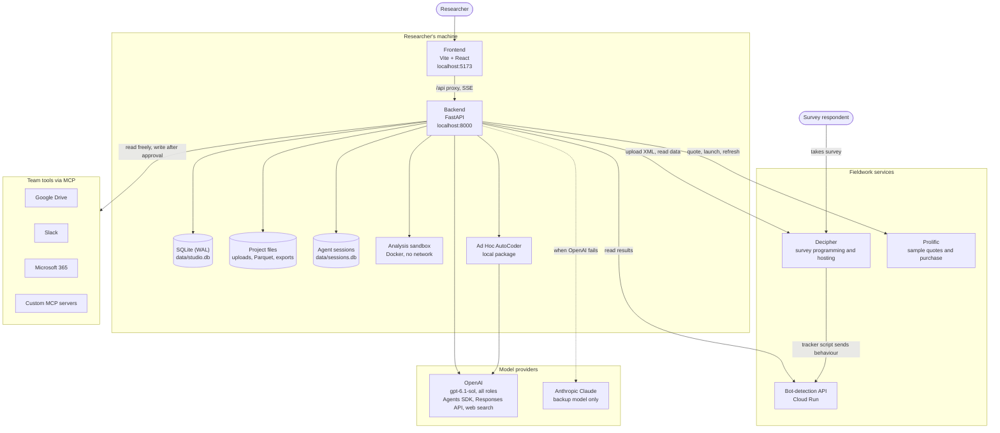
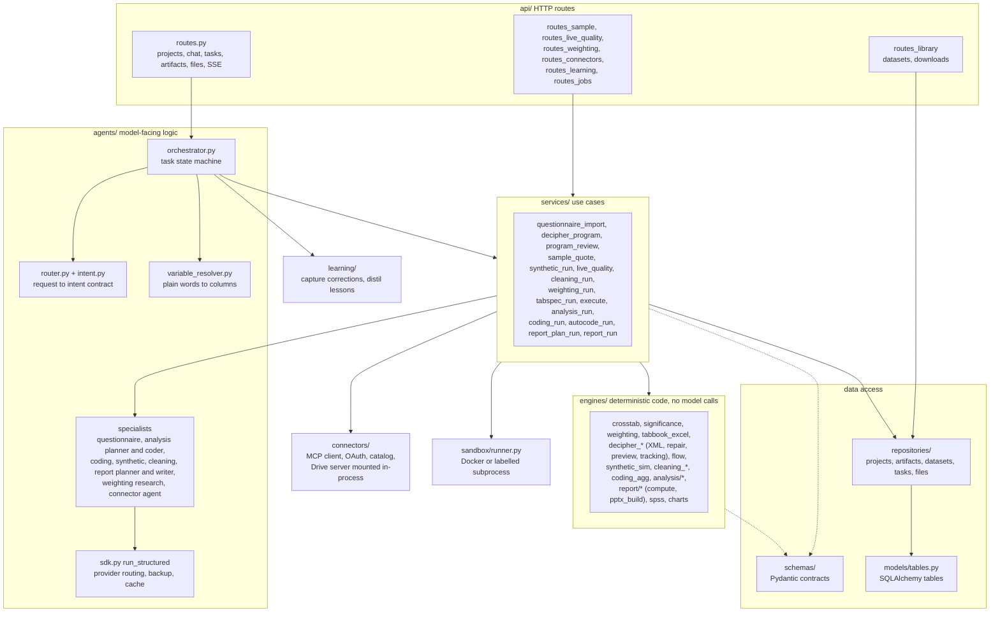
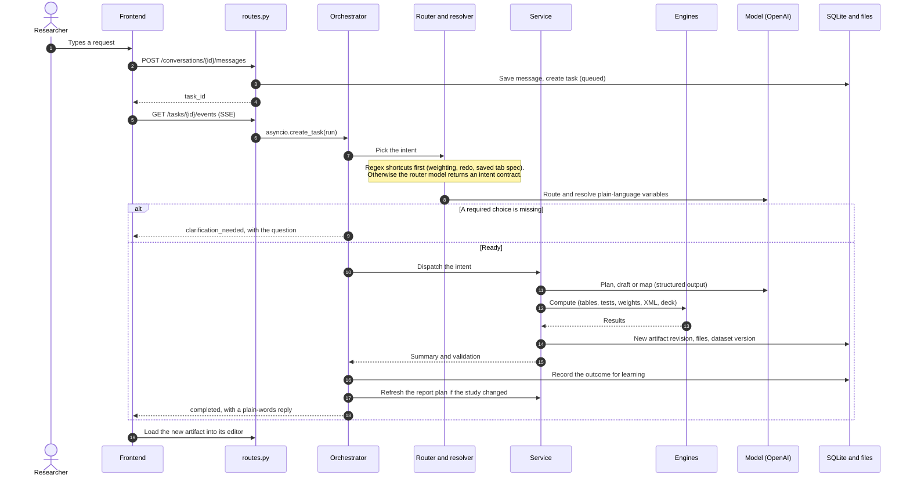
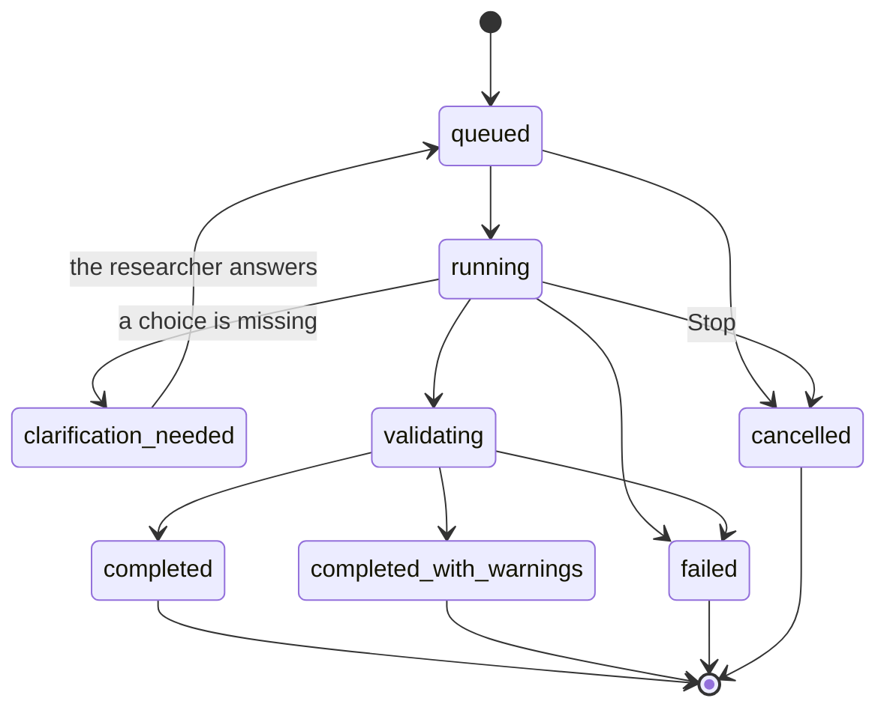
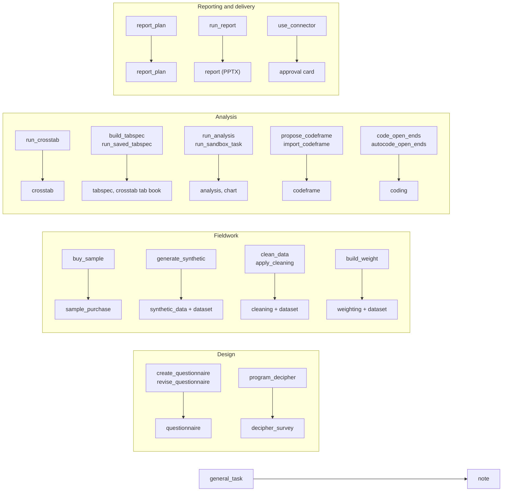
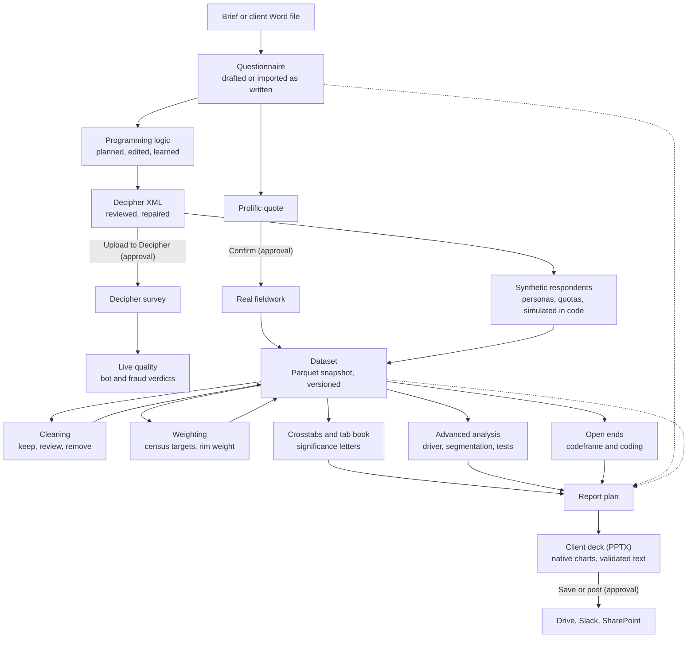
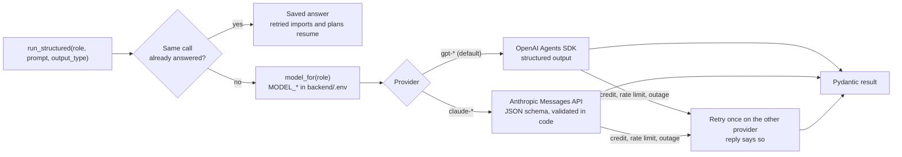
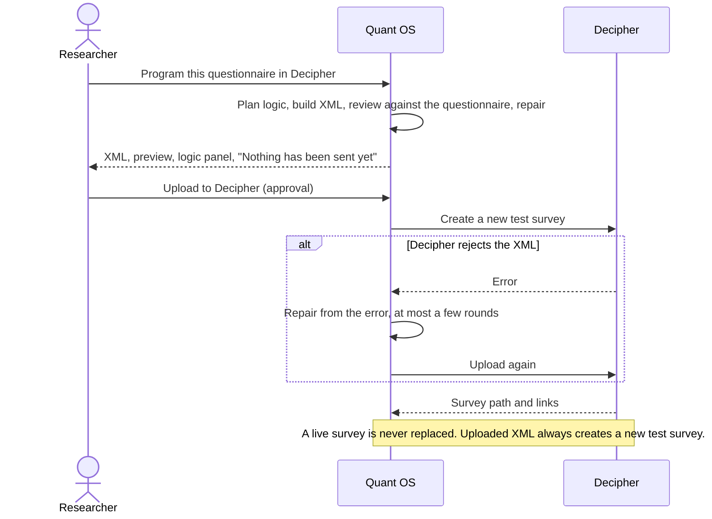
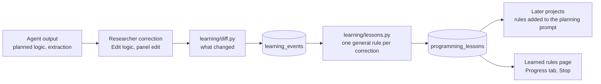

# Quant OS system architecture

Quant OS takes a survey study from a client brief to a client-ready deck. A researcher works in one browser workspace: a chat drives specialist agents, and every output (questionnaire, Decipher survey, tab spec, tables, analyses, codeframe, weight, report) is an editable, versioned artifact.

It runs as a **local single-user app**: a FastAPI backend and a Vite/React frontend on the researcher's machine. Outside services are called only from the backend, so no key reaches the browser.

**Ground rules the design follows:**
- **Numbers come from code, never from a model.** Crosstabs, significance, weights, statistics, code frequencies and every chart value are computed in Python. Models plan, draft, map and write words; a validator checks the words against the computed results.
- **The researcher can edit everything.** Chat edits and panel edits go through the same revision API, with optimistic locking.
- **Nothing outside the app changes without a click.** Decipher uploads, Prolific purchases and connector writes (Drive, Slack and so on) wait for an approval.

Related documents: [DATA_CONTRACTS.md](DATA_CONTRACTS.md) (schemas), [PRD.md](PRD.md) (product), [README.md](README.md) (setup and features), [demo/DEMO_PLAN.md](demo/DEMO_PLAN.md) (demo runbook).

---

## 1. System context

| Boundary | What crosses it | Control |
|---|---|---|
| Browser to backend | Requests, task events (server-sent events) | Vite proxies `/api`; keys stay in `backend/.env` |
| Backend to model providers | Questionnaire text, variable labels, aggregated results, open-end batches | No respondent-level numbers are needed for any computed result |
| Backend to sandbox | A checked analysis script and the data it needs | `--network none`, no API keys, restricted imports and file access |
| Backend to Decipher, Prolific, MCP tools | Survey XML, sample orders, files and messages | Every write waits for an approval card or button |
| Respondents to bot-detection API | Behaviour events from the survey page | Signed survey token; the API stores only allowed event types |

---

## 2. Backend layers

The backend is one FastAPI process. Requests enter through `api`, chat tasks run through the `agents` orchestrator, the work happens in `services`, and anything numeric happens in `engines`, which make no model calls.

| Folder | Role | Rule |
|---|---|---|
| `api/` | HTTP routes under `/api` | Thin: validate, call a service, commit |
| `agents/` | Intent routing, the orchestrator, and every model call | All model calls go through `sdk.run_structured` (or a provider client for web search) |
| `services/` | One module per use case, called by routes and the orchestrator | Commits before long model calls so the database isn't held open |
| `engines/` | Crosstabs, significance, raking, Decipher XML, SPSS, Excel, PPTX, simulation | No model calls, so every number can be reproduced |
| `repositories/` | Database reads and writes | Artifact edits check `expected_version` |
| `schemas/` | Pydantic contracts shared by API, agents and engines | See DATA_CONTRACTS.md |
| `learning/` | Turns researcher corrections into reusable rules | Rules are shown on the Learned rules page |
| `connectors/` | MCP client, OAuth, the connector catalog, and an in-process Drive server | Writes become approval cards |
| `sandbox/` | Runs generated analysis scripts | Docker with `--network none`, or a clearly labelled subprocess fallback |

---

## 3. A chat request, end to end

Every chat message becomes a **task**. The route returns at once, and the orchestrator runs the task in the background, streaming stage messages to the browser.

**Task statuses:**

A finished task can be redone as a different intent ("Run tables", "Run as analysis"); the redo creates a new task from the original request.

---

## 4. Intents and what serves them

The router returns one of these intents. Each maps to one service and produces one artifact type.

---

## 5. The study lifecycle

How the artifacts feed each other over a study. Solid arrows are data flow; dotted arrows are the report plan quietly updating as the study changes.

### Study tools and the logic test

The **Study tools** workspace tab holds three tools. The Decipher viewer has a fourth, the **Logic test** tab.

- **Logic test** (`engines/logic_qa.py`, `POST /projects/{id}/decipher/qa`):
  - Simulated respondents (400 by default) take the stored survey XML the way Decipher would: its `cond` attributes, gotos and `term` elements decide the path.
  - The same answers are then read against the questionnaire's own logic: bases, option and rule terminates (immediate, or held to the end of the screener), and derived groups marked TERMINATE. That logic is evaluated independently of the XML compiler.
  - The first disagreement for each respondent is reported with the answers that caused it. Kinds: the XML skips or shows a question wrongly, a terminate is missing, or an extra terminate fires.
  - Derived variables are worked out from their definitions and given to both sides; the XML's exec code is not run. Select-all grids are not simulated cell by cell, so logic that uses them is listed as not checked.
  - Nothing is sent to Decipher.
- **Tracking** (`services/tracking.py`, `/projects/{id}/tracking…`):
  - A wave is a project. `study_context.tracking` links it into a series (`series`, `wave`, `label`, `previous_project_id`).
  - **Next wave** copies the questionnaire (with its planned logic), tab spec, weighting setup and report plan. It does not copy data, XML or outputs.
  - **Wave changes** compares the two questionnaires question by question and marks what breaks trend comparability: type, wording below 85% similar, added, removed or reworded answers, grid rows, and the base.
  - **Trend tables** read every wave's active dataset and test each wave against the one before it at 95%: an unpooled z-test for percentages and a Welch t-test for means. They use the effective base when a wave has a project weight.
- **Languages** (`services/translation.py`, `/projects/{id}/translations…`):
  - One `translation` artifact per language holds keyed segments of what respondents see: the title, wording, instructions, answers and grid rows. Programmer notes stay in the source language.
  - The model translates missing segments, and segments whose source text changed; brand names, codes, placeholders and HTML are kept as written. A reviewer can edit any segment.
  - Sign-off needs every segment translated against the current questionnaire. A later questionnaire change moves the language to "needs review".
  - Each language exports to Word or PDF, or builds as its own survey XML, which is not uploaded. One Decipher survey holding several languages is not generated.
- **Segments** (`engines/segmentation.py`, `services/segmentation_run.py`, `/projects/{id}/segmentation…`):
  - K-means runs on standardized variables for each segment count in a range. Each solution is scored on silhouette, Calinski-Harabasz, stability, and smallest segment share. Stability is the adjusted Rand agreement with a solution fitted on a different 80% of the sample and a different seed.
  - The recommended solution is the best-separated one with segments of at least 5% and stability of at least 0.6.
  - Profiles show each segment's three most distinctive variables. Segment names start from those variables and are editable.
  - The typing tool is a multinomial logistic regression on the fewest variables whose holdout accuracy is within five points of using all of them. It downloads as an Excel scorer built from formulas.
  - **Add segments to the data** saves `SEG_<k>` with value labels as a new dataset version.

---

## 6. Data model

SQLite (WAL mode) holds the records; files hold the content. Respondent data is stored as Parquet snapshots, and each change (cleaning, weighting, synthetic data) writes a new dataset version and makes it active.

**Artifact types:** `questionnaire`, `decipher_survey`, `sample_purchase`, `synthetic_data`, `cleaning`, `weighting`, `tabspec`, `crosstab`, `analysis`, `chart`, `codeframe`, `coding`, `report_plan`, `report`, `spec_review`, `note`.

**Concurrent edits:** chat and the editors both write through the revision API with `expected_version`. A mismatch returns HTTP 409, and the editor reloads the newer version.

---

## 7. Models and providers

Each agent role reads its model id from the environment. Every role defaults to OpenAI `gpt-6.1-sol`. Any role can be set to a Claude id (`claude-...`), which is then served by the Anthropic Messages API.

| Role | Used for | Session memory |
|---|---|---|
| `orchestrator` | Routing a request to an intent | Conversation session |
| `questionnaire` | Drafting, importing and planning logic | Conversation session |
| `validator` | Program review and checks | Conversation session |
| `tabspec`, `analysis` | Tab specs, analysis plans and scripts | Conversation session |
| `coding` | Codeframe proposals, open-end coding, cleaning open ends | **None**: each batch carries the codeframe (ids, labels, definitions) and its own rows |
| `synthetic` | Personas, quotas and answer profiles | **None**: each slice stands alone |
| `research` | Census targets: OpenAI web search, one search per variable in parallel, then mapping to answer codes | None |
| `general` | Everything else | Conversation session |
| AutoCoder | Ad Hoc AutoCoder (`MODEL_AUTOCODER`, `gpt-5-mini`) | Its own |

---

## 8. Integrations

### Decipher

Some programming conventions are applied in code, not left to the planner:

- **House rules** (`services/special_options.py`) run after every planning pass:
  - On select-all questions, None, Don't know, Not sure and Prefer not to answer are exclusive and anchored.
  - Write-in answers ("specify", "self-describe", "____") get a text box.
  - Other (specify) is not exclusive unless the question's notes say it is.
- **Piped rows** (`row_condition`) are matched to the source question's rows by wording, ignoring case, punctuation and small differences. `rowCond="Q1[row]"` therefore lines up even when the two lists use different codes.
  - A piped row the source doesn't have is reported as a warning.
  - When the source is a select-all, the question also gets `Q1.any` as its base.
- **"Not" bases on a select-all** ("ask if Q5 ≠ 99") are written as `(Q5.any and not Q5.r99)`, so respondents who never saw Q5 are not included.
- **Anchored rows** keep `randomize="0"` both when rows shuffle and when they are sorted A–Z.
- **Copied lists:**
  - A question whose own answers are only None, Don't know or Other gets the source list first, followed by its own answers.
  - The source comes from the plan, or from a note such as "[Same list as X]", "[PIPE IN … from X]" or "[SHOW X LIST]".
  - When the source is a grid, its rows are copied, numbered by position.
- **Scale columns:** a Don't know or N/A point coded apart from the scale (97, 98, or 9 after a 5-point scale) is labelled by its code (`c97`), and only the scale points are numbered.
- **Grids with repeated codes** (either/or pairs coded 1, 2 each) get position-numbered columns and a warning, so the XML stays valid.
- **Derived variables:**
  - A variable computed after another derived variable is emitted right behind it.
  - A variable whose conditions fail the logic check keeps its codes; only the conditions become a to-do.
  - A **count** variable (`compute.kind = "count"`) counts the answers chosen across its source questions, or the number rows above zero. A base such as "ask if 2 or more routes" then compares it with `>= 2`.
  - When a fix needs a variable the questionnaire only describes in words, the planner may define it during a fix round (`merge_derived`). A fix never replaces a variable that already has values.

The review loop (`services/program_review.py`) keeps fixing the XML until it carries out every instruction it can:

1. Round 1 reviews every question. Each round also adds problems found without the reviewer: logic `settle()` set aside as a to-do (an unknown variable, a code the list lacks) and questions that make the XML fail its check.
2. Only the questions with findings are planned again, and the XML is rebuilt.
3. Later rounds re-review only the questions that changed. Findings on questions that didn't change are carried forward without another review.
4. The loop stops when nothing is left, when no question changed, or after 5 rounds. A question that comes back unchanged twice is not retried.
5. Whatever is still open becomes a `PROGRAMMER TODO` in the XML and a warning.

The Decipher survey viewer has three tabs: **Overview**, **To-dos** and **Compare XML**.

- **To-dos** (`services/programmer_todos.py`, `GET|POST /projects/{id}/decipher/todos[/mark|/fix]`):
  - The list is every `unresolved` line on a question or derived variable. Its id is a hash of the owner and the text.
  - **Mark done** moves a to-do to `done_todos`, so it leaves the XML comments. **Reopen** moves it back.
  - **Fix with AI** plans the chosen questions again with their to-dos as problems, then has the reviewer check those questions. Whatever is still found stays a to-do, and to-dos that weren't chosen are kept. The chosen to-dos are saved in `programming.requested` and shown to the reviewer as "requested by the person", so from then on they count as instructions rather than as going beyond the questionnaire.
  - Each action saves a new questionnaire version and rebuilds the XML without uploading. XML programmed elsewhere and uploaded here is never replaced.
- **Compare XML** (`services/xml_compare.py`, `POST /projects/{id}/decipher/compare`):
  - Lines up each question of the generated XML with a pasted or chosen reference XML, using the benchmark's `compare_questionnaire` checks.
  - Shows both XMLs as written, side by side, with a line diff.
  - The reference is used for that one comparison and is never stored.

### Live quality (bot and fraud detection)

When **Add tracking** is on, programming injects `assets/live_quality_tracker.js` into the survey XML with a signed survey token. Respondents' browsers send behaviour events (keystrokes, mouse, focus, page timing, grid answers, open-end text) to the bot-detection API. Quant OS reads that API's verdicts, applies the project's quality rules, and shows the **Live quality** tab and dashboard. The tracker never blocks the survey; ending the survey on a clear bot signal is an opt-in rule.

When the Decipher export is uploaded, `services/quality_merge.py` joins each record's `QOS_SESSION` (falling back to `QOS_RESPONDENT`) to the Live quality rows and writes the verdict, scores and one 0/1 variable per flag as `LQ_*` columns in the same dataset. **Refresh flags** (`POST /projects/{id}/live-quality/merge`) re-applies the current rules as a new dataset version. An unreachable service never fails the upload.

### Prolific

Quotes are free and run live. Launching a study spends money and recruits people, so it needs an explicit confirmation.

### Connectors (Model Context Protocol)

The connector agent picks tools from connected MCP servers: Google Drive (official server, or the Drive API server mounted inside this backend), Slack, Microsoft 365, or any custom server added by URL. Read-only tools run at once. A tool that uploads, posts or changes something becomes a `connector_action` shown as an approval card, and runs only when the researcher clicks **Approve**.

---

## 9. Statistics that matter for trust

| Area | Method | Where |
|---|---|---|
| Significance letters | Unpooled two-proportion z-test within each banner group; Welch t-test for means; uppercase 95%, lowercase 90%; columns at or under the minimum base get "." | `engines/significance.py` |
| Weighted significance | Weighted percentages and means, tested on each column's effective base, (Σw)²/Σw²; weighted SD with an n/(n−1) correction | `engines/crosstab_rows.py` |
| Tab book cover note | Written from the settings actually used, so the note and the letters agree | `engines/tabbook_excel.py` |
| Weighting | Rim weighting (raking) with weight caps (default 0.3–3); respondents with no category keep their own share; efficiency, effective base and design effect reported | `engines/weighting.py` |
| Census targets | Model web search; each reference checked against pages the search opened; targets show their arithmetic and stay editable | `agents/weighting_research.py`, `services/weighting_run.py` |
| Synthetic data | The model writes personas and answer patterns; Python draws every respondent, walks routing and enforces quotas | `engines/synthetic_sim.py` |
| Report text | Sentences that quote a number not in the computed results are dropped | `agents/report_writer.py`, validator |

---

## 10. Learning from corrections

---

## 11. Running it

| Process | Command | Port |
|---|---|---|
| Backend | `cd backend; .venv\Scripts\python.exe -m uvicorn app.main:app --port 8000` | 8000 |
| Frontend | `cd frontend; npm run dev` | 5173 |
| Connector stand-in (demo only) | `cd backend; .venv\Scripts\python.exe -m tests.mock_mcp_server --port 8765 --token demo-token` | 8765 |

Configuration lives in `backend/.env` (copy `.env.example`). Only `OPENAI_API_KEY` is required; Decipher, Prolific, Anthropic, bot-detection and connector credentials each turn on their own feature.

---

## 12. Known limits

- **Weighted advanced analyses:** driver analysis, segmentation and the tests in planned analyses run unweighted. Crosstabs, tab books and the deck use the project weight.
- **Complex survey designs:** stratified or clustered standard errors are out of scope; weighted tests use the effective base.
- **MaxDiff and conjoint** raise `unsupported_method` rather than being approximated.
- **Decipher loops and quotas** are left as programmer to-dos.
- **Logic test:** it simulates the XML locally rather than driving Decipher's own test link, doesn't run exec code, and doesn't simulate select-all grids cell by cell.
- **Languages:** each language builds as its own survey XML; a single Decipher survey holding several languages is not generated.
- **Segmentation** is K-means on complete cases, unweighted.
- **Sandbox fallback:** without Docker, generated scripts run in a labelled subprocess, which is not a secure sandbox.
- **External workbooks:** detection maps a small set of headers and blocks ambiguous significance columns; it doesn't parse every vendor layout.
- **Single user:** the app is local; there is no authentication or multi-user locking beyond `expected_version`.
